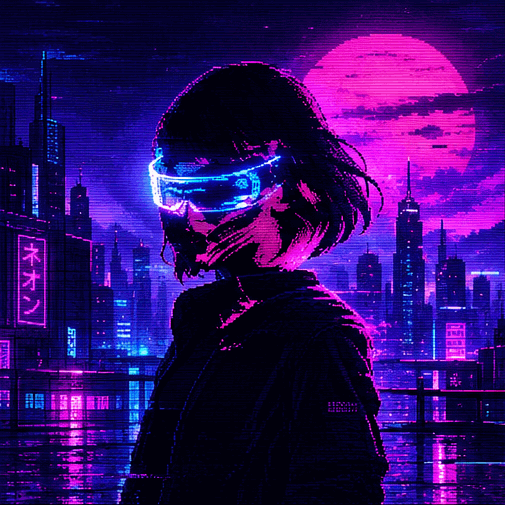
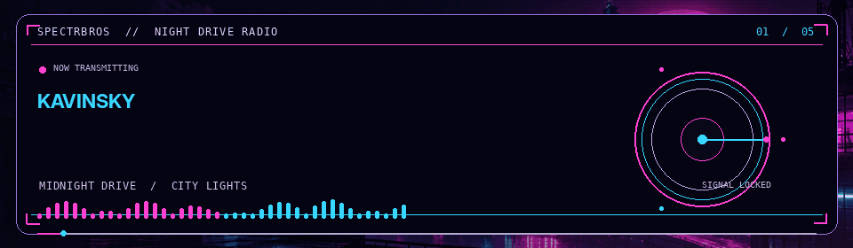

  

   

  

  <h1>SPECTRBROS</h1>

  
<samp>WE GOT WORK TO DO</samp>

  
Ａ　ＱＵＩＥＴ　ＣＯＲＮＥＲ　ＯＦ　ＴＨＥ　ＩＮＴＥＲＮＥＴ

   

  
<i>Somewhere between the neon lights and the silence.</i>

   

  

  
PLAYER 01　//　NEON DISTRICT　//　ONLINE

  

  <h2>NOW PLAYING // NIGHT DRIVE MIX</h2>

  
A SMALL COLLECTION OF SOUNDS FOR THE HOURS AFTER DARK

  

  
KAVINSKY　•　MR.KITTY　•　THE WEEKND　•　MODERN TALKING　•　VØJ x NARVENT

   

  

  
AFTER DARK　•　NO SIGNAL　•　KEEP MOVING

  
TRANSMISSION ENDS // SEE YOU IN THE CITY

